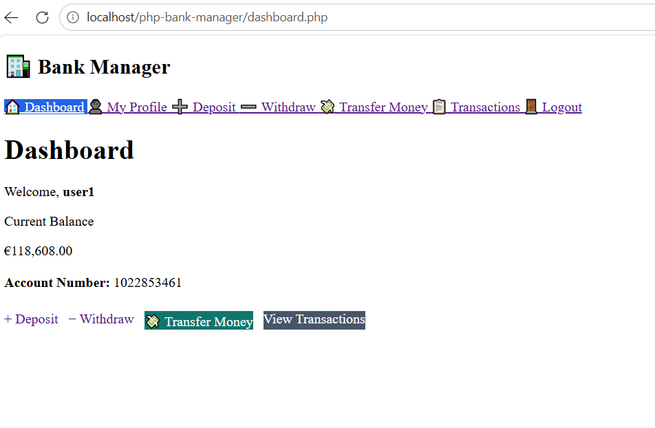
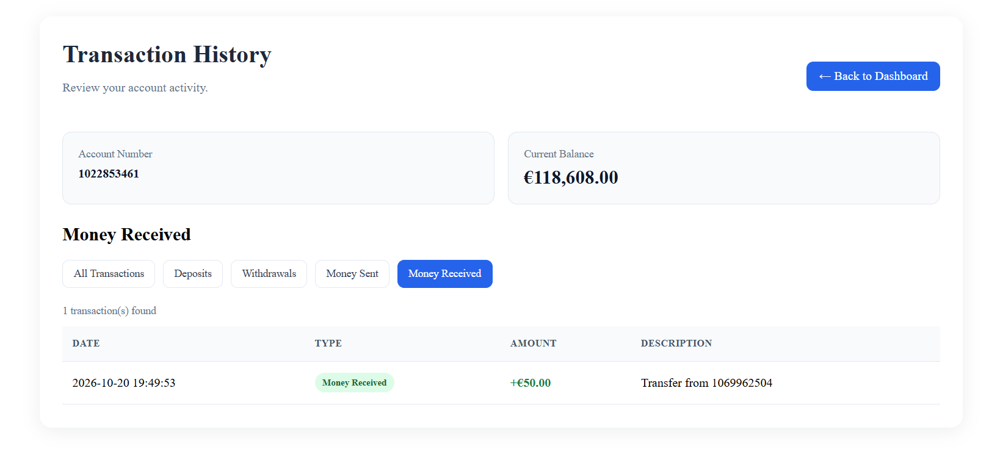
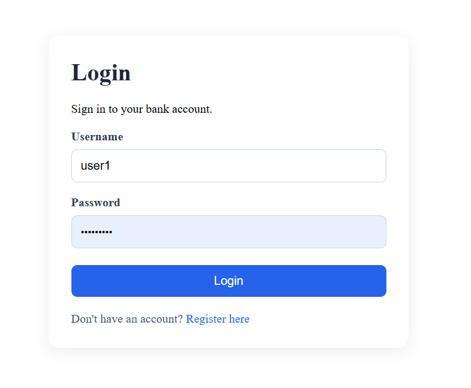
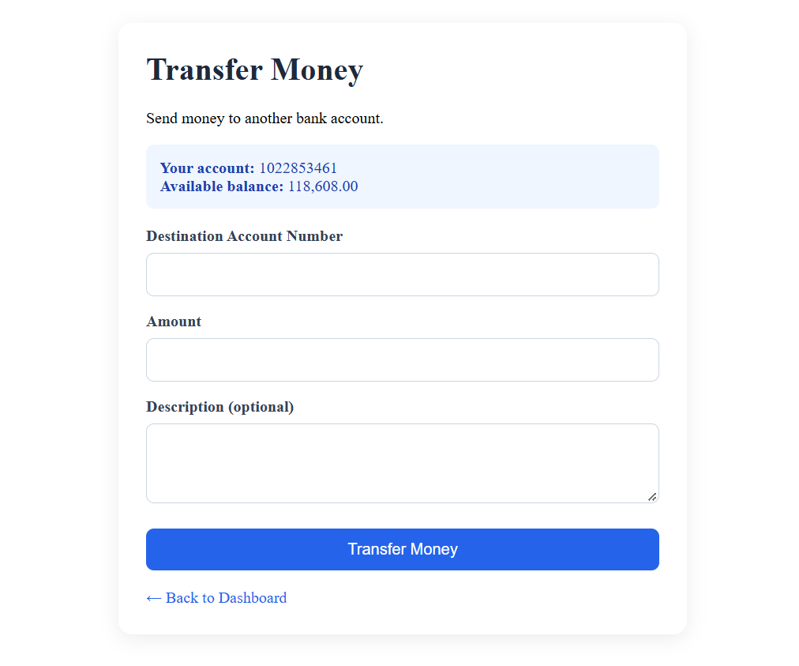
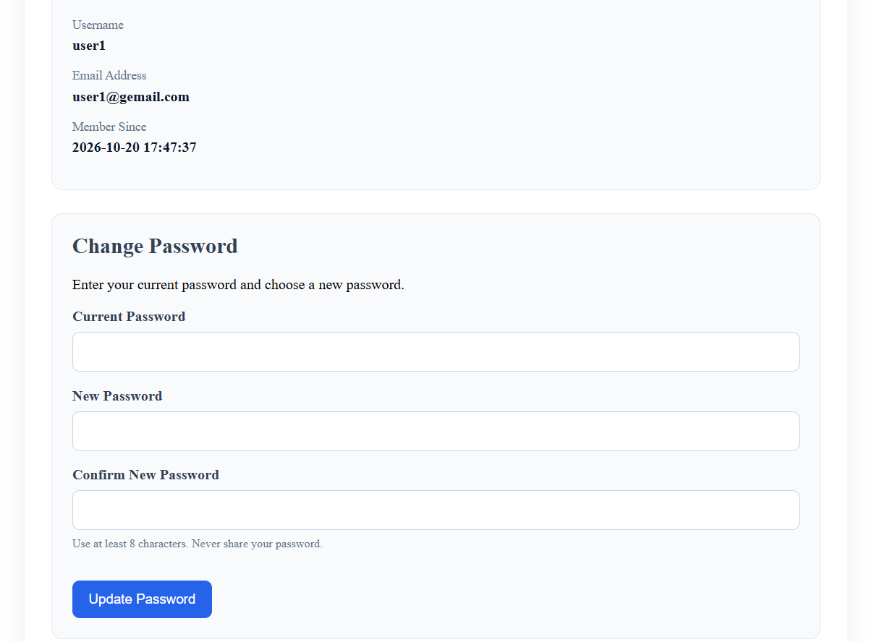
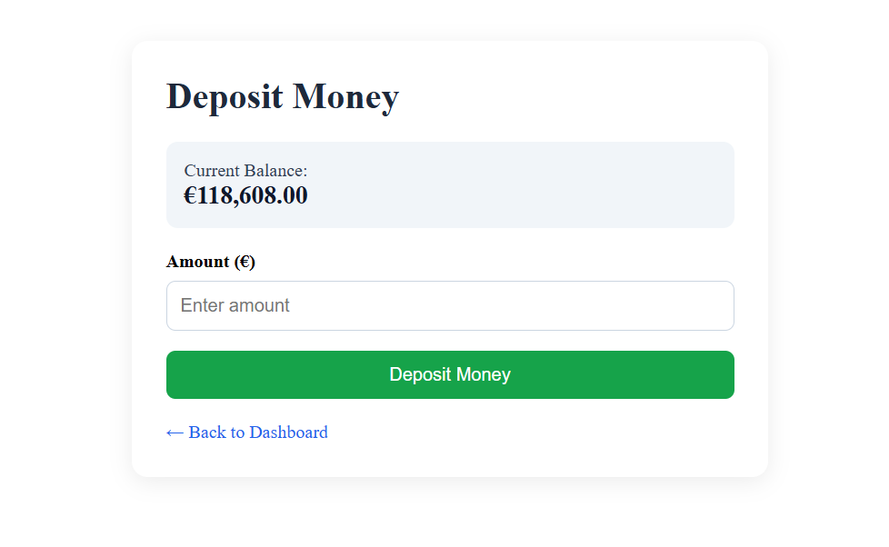
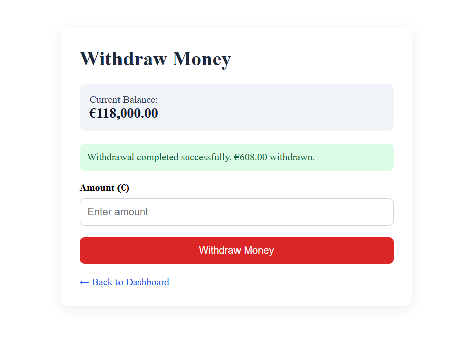

# PHP Bank Manager

A web-based bank account management application built with PHP, MySQL, HTML, and CSS.

This project was developed as a learning project to practice backend development, database integration, authentication, and secure handling of financial transactions.

## Features

- User registration and login
- Password hashing
- Session-based authentication
- CSRF protection for forms
- Automatic bank account creation
- Account balance display
- Deposit and withdrawal operations
- Money transfers between accounts
- Transaction history and filtering
- User profile page
- Password change functionality
- MySQL database integration using PDO and prepared statements

## Technologies

- **PHP 8.2+**
- **MySQL**
- **PDO**
- **HTML5**
- **CSS3**
- **Apache**
- **XAMPP**

## Requirements

- XAMPP with Apache, PHP, and MySQL
- A web browser
- Git (optional, for version control)

## Installation

### 1. Clone or download the project

Place the project folder inside your XAMPP `htdocs` directory.

Example:

`C:\xampp\htdocs\php-bank-manager`

### 2. Start XAMPP

Start the following services:

- Apache
- MySQL

### 3. Create the database

1. Open phpMyAdmin at `http://localhost/phpmyadmin/`.
2. Create a database named `bank_manager`.
3. Create the required tables: `users`, `accounts`, and `transactions`.
4. Configure the database connection in `config/database.php`.

The local XAMPP configuration may use `root` with an empty password. This is only a local development example and must not be used as a production configuration.

### 4. Configure the database connection

Check the database settings in `config/database.php` and update the host, database name, username, and password if necessary.

### 5. Run the application

Open the following URL in your browser:

`http://localhost/php-bank-manager/`

If the project does not have an `index.php` file, open the login or registration page directly, for example:

`http://localhost/php-bank-manager/login.php`

## Security Practices

The project includes several security-related practices:

- Password hashing and verification
- Prepared SQL statements using PDO
- CSRF token validation
- Session ID regeneration during authentication
- Server-side input validation
- Authenticated access to account-related pages

**Disclaimer:** This is an educational project, not production-ready banking software. Real financial applications require additional security reviews, robust auditing, reliable monetary arithmetic, and compliance with applicable regulations.

## Learning Objectives

This project helped me practice:

- PHP backend development
- Relational database design
- SQL queries and foreign key relationships
- User authentication and session management
- Form validation and error handling
- Database transactions
- Basic web application security
- Organizing and documenting a software project

## Future Improvements

- Add automated tests
- Improve error handling and logging
- Add a database schema and sample setup script
- Move secrets into environment variables
- Improve responsive design and accessibility
- Use integer cents or an appropriate decimal-safe approach for monetary calculations
- Add stronger authorization checks and security testing

## Author

**Ahmadreza**

GitHub:
https://github.com/Ahmadreza7577

## Screenshots

### Dashboard

### Transaction History

### Login

### Transfer

### Profile

### Deposit

### Withdraw

